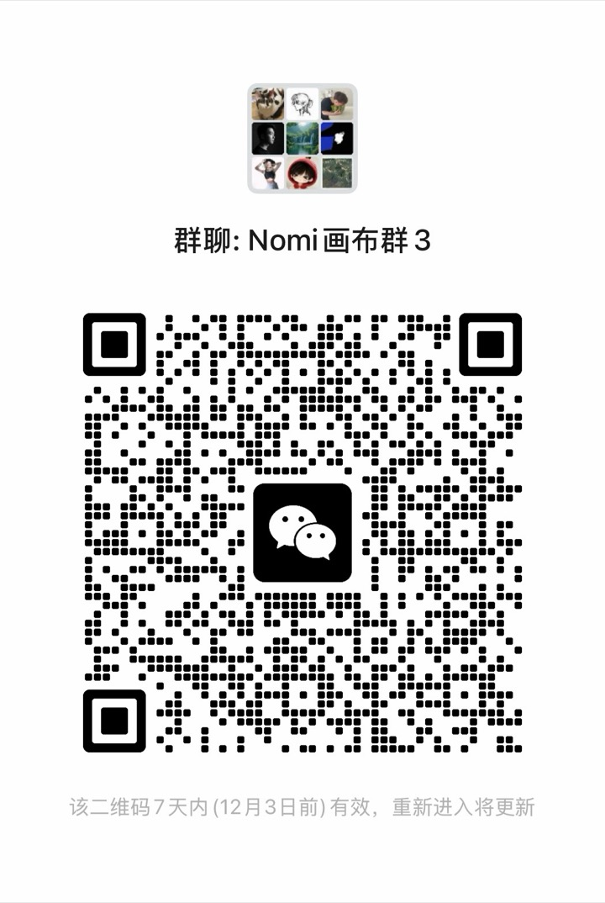

<p align="center">
  <a href="https://nomiaqm.com/en/">
    <picture>
      <source media="(prefers-color-scheme: dark)" srcset="marketing/assets/promo-0.22/cover-en-dark.jpg" />
      
    </picture>
  </a>
</p>

<h1 align="center">Nomi — Open-Source- und Local-first-KI-Videostudio</h1>

<p align="center">
  Sag dem Agenten, was du drehen willst. Er plant die Einstellungen, erzeugt Keyframes und Videos und legt sie auf deiner Timeline ab —<br />
  mit den Modellen, die <em>du</em> anbindest, zum Preis, den <em>dein Anbieter</em> verlangt.
</p>

<p align="center">
  <a href="#download"><b>Download</b></a> ·
  <a href="https://nomiaqm.com/en/">Website</a> ·
  <a href="https://atomgit.com/aqm857886159/Nomi">AtomGit-Mirror</a> ·
  <a href="#film-ansehen">90-Sekunden-Film ansehen</a> ·
  <a href="https://nomiaqm.com/en/quickstart">Schnellstart</a> ·
  <a href="docs/integrate-with-your-agent-en.md">Von deiner KI verbinden lassen</a> ·
  <a href="#community">Community</a>
  <br />
  <a href="README.md">English</a> ·
  <a href="README.zh-CN.md">简体中文</a> ·
  <a href="README.ja.md">日本語</a> ·
  <a href="README.ko.md">한국어</a> ·
  <a href="README.es.md">Español</a> ·
  <a href="README.fr.md">Français</a> ·
  <a href="README.pt-BR.md">Português</a> ·
  <a href="README.tr.md">Türkçe</a>
</p>

<p align="center">
  <a href="https://github.com/aqm857886159/Nomi/releases/latest"></a>
  
  <a href="LICENSE"></a>
</p>

## Auf einen Blick

- **Was es ist:** ein Desktop-KI-Videostudio. Der Agent zerlegt deine Geschichte in einzelne Einstellungen, generiert Keyframes und Videos und legt sie auf einer echten Timeline ab, die du weiter schneiden und als MP4 exportieren kannst.
- **Plattformen:** macOS (Apple Silicon und Intel) sowie Windows.
- **Preis:** Nomi selbst ist kostenlos. Du verbindest deine eigenen Modelle und zahlst direkt an deinen Anbieter zum Originalpreis — kein Nomi-Konto, kein Abo, kein Aufschlag.
- **Modelle:** Seedance, Kling, Wan, Hailuo, Nano Banana, GPT Image und mehr — über APIMart, Kie.ai, Volcengine, ModelScope, eine Dreamina-Mitgliedschaft, beliebige OpenAI-kompatible Endpunkte oder dein lokales ComfyUI.
- **Agenten:** Ein integrierter MCP-Server ermöglicht es Claude Code, Codex oder Cursor, Nomi direkt zu steuern.
- **Local-first:** Projekte, Prompts und API-Keys bleiben auf deinem Rechner.
- **Lizenz:** AGPL-3.0-only seit dem 2026-08-01. Releases bis einschließlich v0.18.1 wurden unter Apache-2.0 veröffentlicht und behalten diese Lizenz.
- **Neueste Version:** siehe [Releases](https://github.com/aqm857886159/Nomi/releases/latest).
- **Hinweis zum Namen:** Dieses Nomi ist eine KI-Video-App. Es steht in keiner Verbindung zum KI-Begleiter-Chatbot Nomi AI unter nomi.ai.

## Sponsoren

Sponsoren helfen dabei, Nomi kostenlos und Open Source zu halten. Ein Sponsor wird niemals zur Standardeinstellung oder fest eingebauten Route: Du bindest nur an, was du selbst auswählst, nutzt deinen eigenen Schlüssel und zahlst direkt den regulären Preis des Anbieters. [Möchtest du hier erscheinen?](#community)

<table>
<tr>
<td width="128" align="center"><a href="https://gway.dev/sign-up?aff=8j8f"></a></td>
<td><b><a href="https://gway.dev/sign-up?aff=8j8f">Gway</a></b> — eine API-Plattform mit Fokus auf KI-Video und Generierung mit mehreren Referenzbildern: Seedance 2.0 / 2.5, Wan 3, MiniMax und weitere führende Modelle, OpenAI-kompatibel und nutzungsbasiert abgerechnet. Nomi hat dafür noch kein eingebautes Preset; klicke auf <b>Let AI connect it for me</b>, und Claude Code oder Codex richten es mit deinem Schlüssel ein. Danke an Gway für das Sponsoring von Nomi! <i>(Die Gway-Links enthalten einen Empfehlungscode.)</i></td>
</tr>
</table>

## Warum Nomi

Relays, offizielle APIs, ComfyUI und lokale Modelle sind günstig. Kommerzielle KI-Videoprodukte betreiben oft exakt dieselben Modelle und verlangen ein Vielfaches dafür.

Nomi gibt dir einen Profi-Workflow auf Basis **deiner eigenen** Modelle. Du zahlst direkt an deinen Anbieter, zu dessen echtem Preis. Selbst der Agent läuft auf dem Modell deiner Wahl — ohne Abo, ohne Aufschlag.

## Film ansehen

[](https://github.com/aqm857886159/Nomi/blob/main/marketing/assets/video/nomi-0.22-film.mp4)

Jeder Screen im Film zeigt die echte Oberfläche von Nomi, und jedes Bild sowie jeder Clip darin wurde mit Nomi generiert.

## Was du damit machen kannst

### Einfach beschreiben — der Agent arbeitet auf deiner Leinwand


Beschreibe den Film, den du machen willst. Der Agent liest deine Leinwand, teilt die Geschichte in Einstellungen auf, erzeugt Keyframes, macht daraus Videos und ordnet die Timeline an. Alles, was er erstellt, landet direkt auf der Leinwand, wo du es sehen und anpassen kannst.

Du bestimmst, wie oft er nachfragt: **Ask each step** (bei jedem Schritt fragen), **Auto-edit** (automatisch bearbeiten — kostenpflichtige Generierungen fragen weiterhin nach) oder **Full auto** (vollautomatisch).

### Regie über jede Einstellung


Im Storyboard steht jede Einstellung in einer eigenen Zeile — Prompt, erstes Bild, Modell, Dauer. Fixiere eine Referenzkarte für eine Figur oder einen Schauplatz, damit jede Einstellung mit ihr dasselbe Gesicht behält.

### Ein 3D-Regisseur in deiner Hand


Positioniere Figuren, stelle Kameras auf und nutze dein Smartphone als Sucher. Die aufgenommenen Frames landen direkt wieder auf der Leinwand.

### Jedes Modell, Einstellung für Einstellung


Seedance, Kling, Wan, Hailuo, Nano Banana, GPT Image und mehr — über APIMart, Kie.ai, Volcengine, ModelScope, eine Dreamina-Mitgliedschaft, ein beliebiges OpenAI-kompatibles Relay oder dein lokales ComfyUI. Wechsle das Modell für eine einzelne Einstellung und generiere einfach einen neuen Take.

### Heute ein neues Modell, heute schon in Nomi

Sobald ein neues Modell erscheint, klicke auf **Let AI connect it for me** und lass Claude Code oder Codex die Anbindung übernehmen. Der Assistent recherchiert Endpunkt, Parameter und Modell-IDs, lässt dich deinen Schlüssel auf Nomis eigener Seite einfügen (der Assistent sieht ihn nie), führt einen echten Testlauf durch und nimmt das Modell in die Liste auf, sobald es funktioniert.

### Ganz deins

Ein Projekt ist ein normaler Ordner auf deiner Festplatte: Leinwand, Storyboard, Timeline, jede generierte Datei und der exportierte Film. Kein Konto. Standardmäßig wird nichts gesendet; anonyme Nutzungsstatistiken sind Opt-in (Settings → Privacy & diagnostics) und lassen sich jederzeit wieder abschalten. Der Code steht unter AGPL-3.0.

**Als Nächstes: KI-Schnitt.** Nomi entwickelt sich zu einem einzigen Studio für alles, was du mit KI produzierst — bau es mit uns zusammen.

## Download

| System | Build | Download |
|---|---|---|
| macOS | Apple Silicon | [Nomi-mac-arm64.dmg](https://github.com/aqm857886159/Nomi/releases/latest/download/Nomi-mac-arm64.dmg) |
| macOS | Intel | [Nomi-mac-intel.dmg](https://github.com/aqm857886159/Nomi/releases/latest/download/Nomi-mac-intel.dmg) |
| Windows | Windows 10 / 11 x64 | [Nomi-windows-setup.exe](https://github.com/aqm857886159/Nomi/releases/latest/download/Nomi-windows-setup.exe) |

Unterstützte Release-Ziele sind macOS arm64/x64 und Windows x64. Installer für Linux, Windows arm64 und macOS Universal werden derzeit nicht veröffentlicht.

<details>
<summary><b>Erster Start unter macOS</b></summary>

Der aktuelle macOS-Build ist **nicht mit einer Apple Developer ID signiert oder notarisiert**, weshalb macOS den ersten Start blockieren kann. Verwende ausschließlich die direkten Downloads oben oder Links von der offiziellen Nomi-Website und dem offiziellen GitHub-Repository.

1. Lade die passende DMG-Datei herunter, öffne sie und ziehe **Nomi** im Fenster auf **Programme (Applications)**.
2. Öffne Nomi aus dem Ordner Programme. Wenn macOS **„Nomi“ nicht geöffnet (“Nomi” Not Opened)** meldet, klicke auf **Fertig (Done)**, öffne **Systemeinstellungen → Datenschutz & Sicherheit (System Settings → Privacy & Security)**, scrolle zu **Sicherheit (Security)**, klicke neben dem Hinweis zu Nomi auf **Dennoch öffnen (Open Anyway)** und bestätige. Seit macOS 15 umgeht ein Rechtsklick mit **Öffnen** diese Meldung nicht mehr; unter macOS 14 und älter funktioniert es weiterhin.

Nur falls macOS meldet, Nomi sei „beschädigt“, prüfe zuerst, ob der Installer von einem offiziellen Nomi-Link stammt, und führe dann aus:

```bash
xattr -dr com.apple.quarantine "/Applications/Nomi.app"
```

Deaktiviere Gatekeeper niemals global. Zum Aktualisieren lade die passende DMG herunter, beende Nomi, ziehe das neue Nomi in den Ordner Programme und wähle **Ersetzen (Replace)**.
</details>

<details>
<summary><b>Erster Start unter Windows</b></summary>

Der Installer besitzt keine Authenticode-Signatur. Wähle im SmartScreen-Hinweis **Weitere Informationen (More info)** → **Trotzdem ausführen (Run anyway)**.
</details>

## Schnellstart

1. **Modell verbinden.** Wähle APIMart oder Kie.ai und füge einen Schlüssel ein — oder füge dein eigenes Relay, einen OpenAI-kompatiblen Endpunkt oder dein lokales ComfyUI hinzu. Keine Lust auf manuelle Einrichtung? Gib [Von deiner KI verbinden lassen](docs/integrate-with-your-agent-en.md) an Claude Code oder Codex weiter.
2. **Sag, was du drehen willst.** Schreib es ins Agenten-Panel oder starte mit einer Geschichte im Storyboard.
3. **Regie führen und exportieren.** Behalte deine besten Takes, ordne die Timeline und exportiere als MP4.

> **Hinweis:** Der APIMart-Link enthält einen Empfehlungscode. Du zahlst Anbieter immer direkt mit deinem eigenen Schlüssel zu deren regulärem Preis. Nomi leitet niemals Inferenz durch einen Proxy weiter und verkauft sie nicht weiter; jeder Anbieter lässt sich durch deinen eigenen Endpunkt ersetzen.

Mehr dazu: [Schnellstart](https://nomiaqm.com/en/quickstart) · [Erstes Modell verbinden (Englisch)](docs/guide/model-connection-en.md) · [Benutzerhandbuch](docs/user-guide.md) · [Anbieter](docs/provider-integration.md) · [CLI + MCP](docs/guide/capability-core-cli-mcp.md)

## Nomi über deinen eigenen Agenten steuern

Nomi enthält einen MCP-Server mit 24 MCP-Tools, sodass Claude Code, Codex oder Cursor Nomi steuern können — generieren, anordnen und bearbeiten — und dabei die Credits aus deinem bestehenden Agenten-Abo mitnutzen. Siehe [Von deiner KI verbinden lassen](docs/integrate-with-your-agent-en.md).

## Community

- Fragen, Workflows und Ausblick: [GitHub Discussions](https://github.com/aqm857886159/Nomi/discussions)
- Fehler und Funktionswünsche: [GitHub Issues](https://github.com/aqm857886159/Nomi/issues)
- Release Notes und kurze Demos: [X / Twitter](https://x.com/sdf297417627618) · [Bilibili](https://www.bilibili.com/video/BV1Lf8b6nEjf/)

WeChat-Nutzer können den Code links scannen, um der Nutzergruppe beizutreten. Falls der Gruppencode abgelaufen ist, füge den Maintainer (rechts) unter **TZ857886159** hinzu.

<p align="center">
  <a href="docs/media/nomi-canvas-group-wechat-2026-12-03.jpg"></a>
  &nbsp;&nbsp;
  <a href="docs/media/qingyang-wechat.jpg"></a>
</p>

Einen Bug gefunden? Der Code ist offen — schicke die Fehlermeldung zusammen mit dem [Issue-Fix-Prompt](docs/guide/codex-issue-fix-prompt-en.md) an Claude Code oder Codex; oft kann er das Problem direkt für dich patchen. Alles, worauf alle stoßen, sag uns bitte — wir übernehmen es in die Hauptlinie.

## Für Teams

**Individuelle Builds**, **Integrationen**, **AGPL-konformes Deployment** und **laufende Weiterentwicklung** für Teams, die Nomi in einem echten Produktions-Workflow einsetzen möchten. [Projekt besprechen](https://github.com/aqm857886159/Nomi/issues/new?template=business_inquiry.yml) — das Formular ist öffentlich, teile daher nur eine nicht vertrauliche Zusammenfassung und poste niemals Zugangsdaten, private Kontaktdaten, Budgetdetails oder durch NDA geschützte Informationen.

## Entwickler

Erfordert Node.js 20+ und pnpm.

```bash
git clone https://github.com/aqm857886159/Nomi.git
cd Nomi
corepack enable
pnpm install
pnpm dev
```

```text
electron/    Electron main process, local runtime, storage, and model calls
src/         React + Vite + Tailwind workbench
skills/      Skill Pack v2; see docs/skill-pack-format.md
```

Nützliche Prüfungen: `pnpm run test` · `pnpm run typecheck` · `pnpm run gates`

Research-Tools (um zu durchsuchen, worüber Creator auf Douyin / Xiaohongshu / Bilibili / X sprechen) lesen ihren Schlüssel ausschließlich aus der Umgebungsvariable `TIKHUB_API_KEY` — siehe [`docs/research/tikhub-api-notes.md`](docs/research/tikhub-api-notes.md).

## Mitwirken

Fehlerberichte, Funktionsvorschläge, Dokumentation und Code-Beiträge sind herzlich willkommen. Beitragende müssen kein CLA unterschreiben; Beiträge werden unter AGPL-3.0-only angenommen.

- [Fehler melden](https://github.com/aqm857886159/Nomi/issues/new?template=bug_report.yml)
- [Funktion anfragen](https://github.com/aqm857886159/Nomi/issues/new?template=feature_request.yml)
- [Frage stellen oder Idee teilen](https://github.com/aqm857886159/Nomi/discussions)

## Lizenz

Aktuelle Releases stehen unter AGPL-3.0-only; frühere Releases, die unter Apache-2.0 veröffentlicht wurden, behalten ihre ursprüngliche Lizenz.

Siehe [LICENSE](LICENSE). Bezahlte Leistungen können AGPL-konforme Individualentwicklung, Integration, Deployment, Schulung und laufende Weiterentwicklung umfassen. Nomi bietet keine Closed-Source-Distribution an, die den zugehörigen Quellcode zurückhält.
