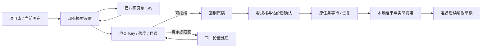

# APIMart 接入与持续创作：整合设计
日期：2026-11-03。**可评审设计包 / exploration，未实施到产品。**

[打开交互预览](preview.html) · [接口与实现合同](contracts.md) · [设计卡](design-card.md) · [验证记录](verification.md)

本包整合两件事：一是接入全阶段页面；二是新增接口带来的功能、页面和实现边界。预览的左侧阶段目录、右侧接口注释只是评审工具，Nomi 产品中仍只有项目库、设置和画布三个宿主。

## 产品决策
1. 新用户默认推荐 APIMart；先解释能完成什么，再让用户连接。老用户已有模型、连接、项目照常使用。
2. 新人只填 Key；服务地址、模型与参数预置。地址、协议、额外 header 等高级能力保留，不因简化丢失。
3. 连接成功直接返回原操作，不插入强制成功页；只检查连接和模型目录，不声称生成效果已验证。
4. 费用参数始终可见。继续做视频、出 2K、局部编辑等动作只准备草稿，用户再次确认才提交。
5. 不建 Nomi 钱包，不代登录付款。邀请推荐关系清楚说明；未确认的优惠、用户数、稳定性数字不展示。
6. 优先减少失败返工与跨页查找，不以模型目录数量作为完成标准。

## 页面与阶段清单

同一个页面有多种状态；不是让用户连续点 18 个页面。下列 ID 与预览、接口合同对应。

| ID | 触发 / 宿主 | 画面与主操作 | 完成后 |
|---|---|---|---|
| S01 | 无可用连接 → 项目库 | 作品示例、推荐理由、价格依据、连接入口；已有连接出口 | 打开 S02；可先看作品 |
| S02 | 项目库或生成按钮 → 设置/模型/APIMart | 官网拿 Key 的说明 + 一个输入框；高级连接收在次级 | 检查进入 S04 |
| S03 | 从 S02 去官网 | 官网交接示意：登录/注册→创建 Key→复制；Nomi 保留窗口 | 切回 S02，焦点到 Key；不仿制登录表单 |
| S04 | 点击连接检查 | 身份检查、账户资金、Key 额度、模型目录分别反馈 | 核心检查成功回 S07；辅助信息失败可继续，错误 S05 |
| S05 | 检查失败 → 同一设置 | 已保存待检查 / Key 无效 / 网络不可达 / 无可用已适配模型，分别给下一步 | 在原设置修正或使用其他连接 |
| S06 | 资金问题 → 同一设置 | 账户余额与 Key 额度；零余额/付款待核对/Key限额三变体 | 官方充值或调整 Key；刷新后回原稿，不自动提交 |
| S07 | 连接成功 / 已有连接 → 原画布 | 原提示词、参考素材、规格和连接仍在 | 选择模型 S08、费用 S09、确认生成 |
| S08 | 当前模型选择器 | 当前任务可用且 Nomi 已适配的模型、能力差异与未试跑状态 | 更新该草稿；不改变历史任务或全局默认 |
| S09 | 费用说明展开 | 当前规格、计费单位、估价依据、时间戳、适用条件与已知预扣 | 关回原 composer；未知报价有处理出口 |
| S10 | 确认生成 → 当前节点 | 服务端状态、进度/估计时间（有才显示）、原任务身份 | 完成 S12；查询中断 S11 |
| S11 | 提交不确定 / 查询中断 / 下载失败 | 分别核对原请求、取回原任务或重下原结果 | 恢复同一任务，不盲目新增付费请求 |
| S12 | 任务完成 → 结果节点 | 本地结果、真实费用来源、后续动作；部分成功单独说明 | 出 2K / 局部修改 / 视频编辑 / 音乐处理 |
| S13 | 合格 H3 768P 结果 | 「准备 2K」继承源任务与素材，不让用户手填 taskId | 新派生草稿，规格与报价确认后提交 |
| S14 | 图片结果 → 局部编辑 | 画选区、改动描述、保留原图；mask 尺寸跟原图 | 新派生图，沿源资产保留关系 |
| S15 | 视频结果 → 编辑/续拍 | 模式、源片段、描述、长度约束、预扣提示 | 生成新派生片段，不覆盖原视频 |
| S16 | 音乐结果 → 后处理 | 分离人声/伴奏、延长或替换片段；当前输入来源可见 | 准备任务并确认，结果仍归原作品 |
| S17 | 连接余额入口 → 设置 | 账户/Key余额、平台近期用量、模型分布与刷新时间 | 管理 Key、充值、回当前作品 |
| S18 | 高级/已有连接 → 设置 | 多连接、地址编辑、模型管理、导入导出、诊断等保留入口 | 使用既有流程；不覆盖旧连接 |

连接异常、充值待核对、报价未知、部分成功和能力缺失可通过预览的「状态」选择器查看。高级流程只展示原有入口的归宿，不假装在 HTML 实现真实连接管理。

## 接入流程



- 不强制先注册再看示例；不要求用户在 Nomi 内选择协议和填模型 ID。
- 浏览器回来不证明账户已登录、已付款或邀请已绑定；只有接口明确返回的事实进入状态。
- 重复打开接入不重建当前项目、不清空 composer。返回上下文是 projectId + nodeId + surface + focusTarget，保存在本地会话；付费意图不随之自动执行。
- 更换 Key 使用候选校验，成功后走现有保存路径；失败保持旧凭据。取消修改不改变已有连接。
- 用户选其他连接即按该连接创作，不暗中切回 APIMart。

## 功能、接口与页面对应

详见 contracts.md 的 F01–F14；预览「功能与接口」页可直接跳到对应屏。

| 功能 | 接口/依赖 | 页面 | 优先级 |
|---|---|---|---|
| F01 一次连接 | balance + models + 现有凭据保存 | S02–S05 | 第一阶段 |
| F02 账户与 Key 额度 | user/balance、balance | S06、S17 | 第一阶段 |
| F03 模型与参数 | models 分类、单模型 schema | S07、S08 | 第一阶段 |
| F04 估价与预扣 | pricing/model + 模式合同 | S09、S13–S16 | 第一阶段 |
| F05 任务恢复 | 原 taskId 查询；部分模型幂等 | S10、S11 | 第二阶段 |
| F06 素材与过期 | uploads/images + 现有素材链 | S07、S11、S14–S16 | 第二阶段，视频编辑前置 |
| F07 实际费用/用量 | tasks 费用、usage 聚合 | S12、S17 | 第一/二阶段 |
| F08 H3 2K | videos/generations + source_task_id | S13 | 第三阶段优先 |
| F09 局部改图 | GPT official mask / Grok region_edit | S14 | 第三阶段 |
| F10 视频编辑续拍 | Seedance 2.5 omni_reference_task_type | S15 | 第三阶段 |
| F11 音乐后处理 | Flow Music clip_id 操作 / Suno 原任务操作 | S16 | 后续阶段 |
| F12 连接管理保留 | 现有连接、诊断、导入导出入口 | S18 | 全程 |
| F13 缓存与通知 | 文本缓存；任务 webhook | 现有 AI 策略 / 任务通知，暂不新增屏 | 暂缓，见合同进入条件 |
| F14 合作接入 | 第三方授权、订单、邀请、音视频直传 | S03、S06 的未来替换 | 取得正式契约后另排 |

## 各类输入与结果的持久化

连接和密钥沿已有保存路径；任务身份、费用、输入快照沿 Run/task；本地媒体沿 projectAssetStore。设置里只是投影，不能再存一套生成任务。模型 schema 是目录外部资料，经过转换与准入，不直接执行任意表达式。历史任务使用提交时冻结的身份与模式，目录更新不改旧任务。

新增账户快照不进项目文件，不缓存明文 Key，不在日志写余额响应原文或认证头。公开报价带来源/时间，与个人账户价分开。所有事实按 connectionId 和 credentialRevision 隔离，切换 Key 后丢弃旧连接的在途返回。

## 中途与异常行为

| 阶段 | 关闭/切走 | 断网 | 重启 | 连点 |
|---|---|---|---|---|
| 未提交连接 | 原稿与已保存连接保留；未保存 Key 输入清除 | 当前表单可改地址/重试 | 重开原项目；不保存未提交 Key | 只打开一个设置宿主 |
| 检查中 | 取消本地等待；候选 Key 不覆盖旧连接 | 分类错误，不一律判 Key 无效 | 重新只读检查 | 单请求组，检查中禁用提交 |
| 充值返回 | 保留草稿；余额刷新是独立动作 | 显示上次更新时间或未知 | 不推断订单结算 | 不重复发起支付 |
| 生成提交中 | Run 记录原请求身份；UI关闭不等于取消 | 有 taskId 查原任务；无 ID 按幂等契约核对，否则待核对 | 原任务/请求身份恢复 | 使用现有提交去重门 |
| 查询中 | 可继续其他创作；本地停止等待不声称退款 | 退避查询原任务 | 原 ID 重建 | 只有一个取回过程 |
| 下载中 | 原任务成功事实保留 | 仅重下原结果；链接过期按对应模型处理 | 本地原子保存状态重建 | 已有落地门复用 |
| 编辑草稿 | 保存派生草稿，不动源资产 | 先允许编辑；提交时说明依赖 | 源任务与资产关系保留 | 准备动作去重，不自动生成 |
| 部分完成 | 已成功产物可用，缺失部分独立展示 | 不整批重跑 | 按原任务收据恢复 | 重试缺失部分需独立确认 |

取消接口未证实的路径，不提供「取消并退款」。账号切换、端点修改、节点删除都要使旧的界面请求失效，不把旧账户余额或旧节点结果写入新对象。

## 实施拆分与准入

| 顺序 | 最小可交付切片 | 要改的现有边界 | 验收与放行 |
|---|---|---|---|
| I1 | 接入卡、同一设置、返回原稿、原功能保留 | SettingsDialog / OnboardingDrawer / vendor connection UI | 真实新旧用户流程、zh/en、键盘、窄窗、草稿不丢；不发生成 POST |
| I2 | 两种余额、用量、状态分类 | 主进程账户读取 + IPC + 同一设置 | 无 Key 泄漏、跨连接晚到返回丢弃、未知≠零、付款返回不生成 |
| I3 | 模型 schema 与费用 | catalog/archetype/admission + deriveShotPrice | 普通/official 不混、参数组合拒绝、报价来源/时间/单位正确；未知报价不伪装 |
| I4 | 逐模式幂等、素材覆盖、恢复呈现 | provider / Run / assetIngestion / taskResultQuery | 提交断网与重启、原任务查询、下载失败不重生成；证据不足的路径不自动重试 |
| I5 | H3 2K、蒙版局部编辑 | 现有派生节点/模式与 mapping | 源任务所有权与资格、Alpha/原图尺寸、显式确认、实际费用、本地产物闭环 |
| I6 | 视频编辑续拍、音乐后处理 | 原视频/音频节点 + 对应模型契约 | 素材运输先过；预扣与实付分开；模式不匹配有下一步；不覆盖原产物 |

每片先正式设计板与生产组件对账，再代码实现；每个付费模式按仓库护栏先演练再真跑一次。生产测试以最终变更路径确定；本 PR 只验证设计包。后续 PR 不得把这里的截图或文档测试当作付费生成收据。

## 页面与现有组件落点
- 入口：项目库现有连接/引导位置；模型设置宿主为 SettingsDialog，通过 vendorKey 定位。
- 参数：现有 Node composer / InlineParameterBar；不在聊天里另建编辑器。
- 状态与费用：现有任务展示、ProvenancePanel，使用原 taskId 与实际费用。
- 派生动作：选中结果后的情境菜单，不把所有模型功能平铺到常驻顶栏。
- 高级控制：同一设置的原入口；不从原型缺少一个控件推导要删除它。

## 验收清单（后续实现也必须覆盖）
A01 入口可跳过；A02 一次 Key 与高级地址并存；A03 原位置返回；A04 认证成功不等于所有模型试跑；A05 两种额度不混；A06 余额未知可解释；A07 目录交集与 schema 限制；A08 同规格报价；A09 预扣/估价/实际费分开；A10 不确定提交不盲重发；A11 查询/下载不发生成；A12 素材过期可恢复；A13 部分产物保留；A14 编辑动作只建草稿；A15 旧连接与任务保留；A16 明暗/中英/键盘；A17 支付/授权/邀请不伪造；A18 隔离跨连接缓存；A19 prompt 不暗改；A20 高级功能普查无遗漏。

## 资料与证据
官方接口研究日期 2026-11-03：163 篇 API 目录 + 7 篇指南已做结构扫描，重点契约已核对。这里只纳入需要实施的合同与官方链接，不提交文档镜像、真实凭据或私有商业资料。网页有接口不代表当前安装包已实现，也不代表各地区可用。


## 本地预览

在仓库根目录运行（复用现有 tokens 和随包图片，因此需以仓库根为服务目录）：

```sh
python3 -m http.server 8771 --bind 127.0.0.1
```

打开 `http://127.0.0.1:8771/docs/design/proposals/2026-11-03-apimart-experience/preview.html`。顶部可切页面、功能接口、实施顺序；左侧选择阶段，右侧切正常/异常状态。URL 支持 `?screen=S17&lang=en&theme=dark`。停止本地服务器即可关闭服务，不需要构建或安装新依赖。

[入口样张](screenshots/01-entry-zh-light.png) · [接入设置](screenshots/02-connect-zh-light.png) · [局部编辑](screenshots/03-region-zh-light.png) · [账户用量](screenshots/04-usage-en-dark.png)
