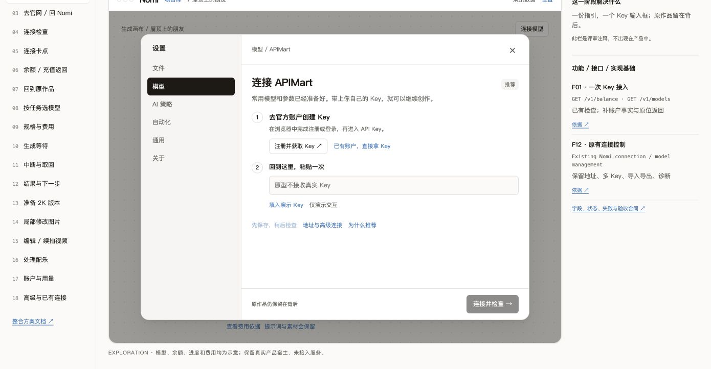
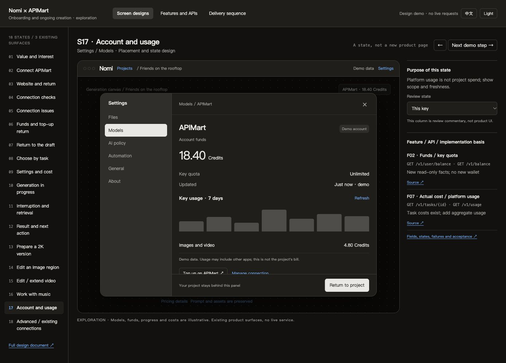

# 设计包验证记录

日期：2026-11-03。范围仅为设计文档与 HTML exploration；没有生产 API 接入或真实付费生成。

## 自动检查

执行 `node docs/design/proposals/2026-11-03-apimart-experience/check.mjs`：通过。

- 18 个页面状态与 14 项功能引用闭合；每项功能都有接口合同。
- 82 次中英文状态/变体渲染，素材路径存在，无未解析字段。
- 切模型、分辨率或派生模式时不沿用原图片估价；视频/音乐不显示按张计费。
- 提示词转义、空草稿保留、无选区禁用、不确定提交不重提、音轨包只重试导入。
- 原型限制联网请求、Key 输入只读；不使用真实凭据。
- 评审状态选择器闭合，后续 API 注释不被吞入原生下拉菜单。

使用仓库 Prettier 检查 HTML/CSS/MJS；MJS 经 Node 解析。推送前运行仓库门岗，具体收据以 PR 检查为准。

## 浏览器走查

macOS Chrome，默认视口约 1390×723；实际打开并观察画面，非仅根据源码推断。

| 路径 | 观察 |
|---|---|
| 18 个页面 × 中文/英文 | 共 36 屏可渲染，所需图片没有破图 |
| 全部 18 个页面的接口说明 | 右侧功能/接口注释均可见 |
| 示例→输入草稿→连接设置→官网交接→返回 | 保留原提示词；交接为演示，不打开真实账户页 |
| 保存待检查→检查已保存连接→下一步 | 回原画布，原提示词仍在；不要求重新复制 |
| 选择不同模型→查看费用 | 显示该规格报价未知，无沿用原示例价格 |
| 局部编辑清空选区→重新选区→准备→生成演示 | 无选区禁用；准备只到派生草稿；报价未知时进入费用说明 |
| 音轨导入失败→重试原包 | 明确只处理原包，没有重新分轨 |
| 推荐依据弹层→Escape | 关闭解释弹层 |
| 中文浅色 / 英文深色 | 亲眼检查并保存样张 |
| 760×900、390×844 窗口 | 接入主操作可通过滚动到达，390 宽无整页横向溢出；复位视口 |
| 控制台 | 本轮走查未捕获 error |

HTML 的高级入口只演示归宿，选区是预置示例，金额/用量/进度均为明确标注的固定演示数据。没有实现完整的生产对话框焦点管理、真实上传、余额查询、登录、支付和任务执行。

## 独立设计复核

验收线：`/root/apimart_design_review`，与设计实现线 `/root` 分离。只读核对契约、文档和交互代码；功能普查另由 `/root/repo_provider_audit` 核对现有入口。

| 复核发现 | 已纳入修正 |
|---|---|
| 用量查询分组枚举 | 使用 `group_by=date`，scope 与 model 分开 |
| 未验证保存路径被遗漏 | 新连接保留 verificationPending；替换失败不覆盖旧 Key |
| 分轨结果是 ZIP | 增加下载、解包边界、媒体校验、原子导入、失败重试原包 |
| 平台 schema 覆盖用户配置 | 受管元数据与契约候选分开；自定义配置不自动覆盖 |
| Seedance 编辑声明字段 | 改为 `omni_reference_task_type`；保留上游按 prompt 再分类限制 |

复核结论：上述字段修正后，可提交本次设计资料与 exploration 范围的 PR。实现线已对照官方快照修正所有对应文案与 JSON 示例，并补入真实人脸需要已审核素材库引用的准入限制。

## 样张

## 尚未验证

真实 API 响应、账户余额、付费生成、退款、Windows 安装包、国内外网络和新手完成率均未验证。未取得 OAuth、订单/邀请查询、通用音视频直传完整契约。正式 Claude Design 板与生产组件对账属于后续实施准入；本包不是获批设计板。
