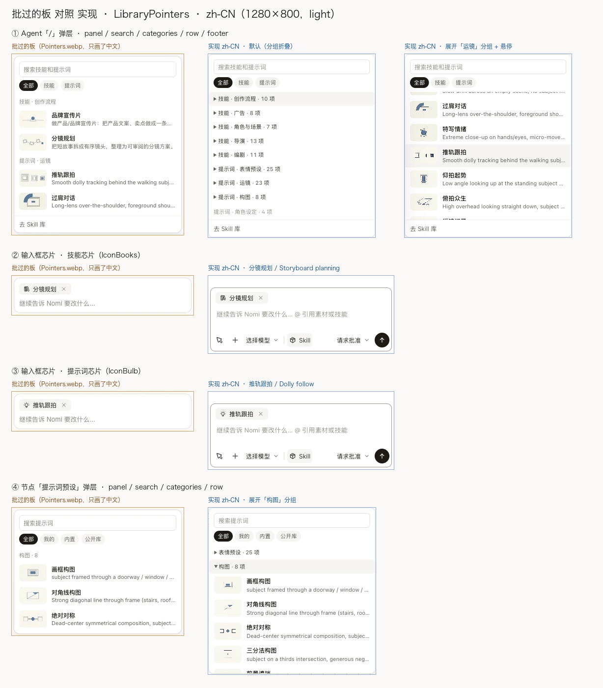
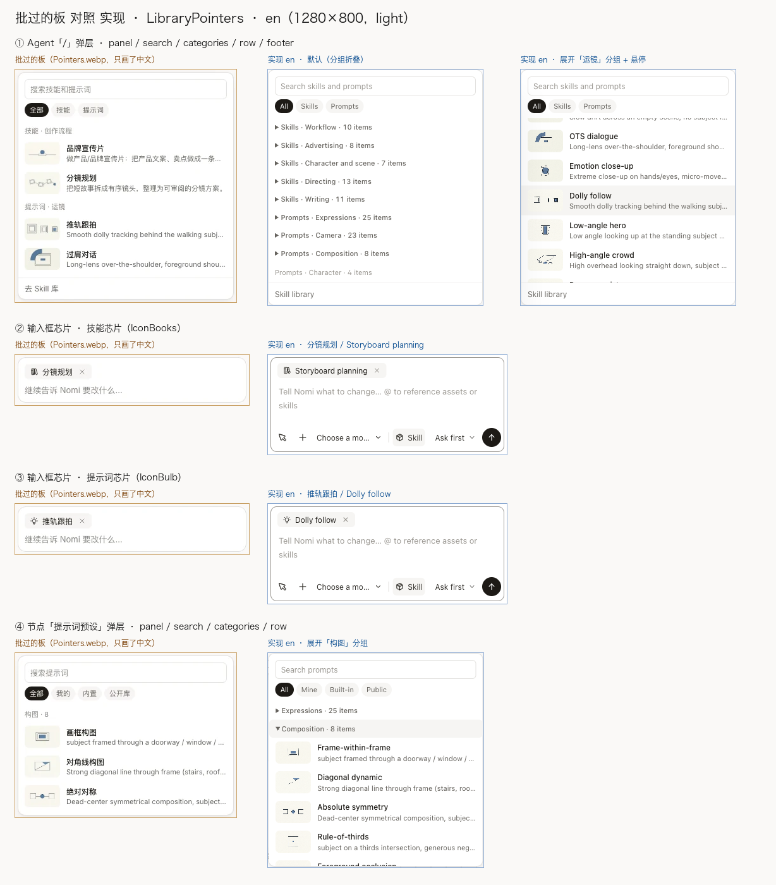

# 批过的板 ↔ 实现（中英对照）· LibraryPointers · PR #1623

- 板：`docs/design/boards/2026-10-24/LibraryPointers.board.json`，样张 `docs/design/boards/2026-10-24/preview/Pointers.webp`（用户 2026-10-24 拍板；板上只画了中文，英文没有单独样张，下面「en」列拿中文板对译文）。
- 实现：真 Electron 隔离窗口，`1280×800`、浅色、空库；`zh-CN` 与 `en` 各走一遍同样的路径（项目内 `/` → 展开分组 → 点行挂芯片 → 画布图片节点「提示词预设」）。全窗口截图在 [`board-vs-impl/`](board-vs-impl/)，拼好的对照图：
  - 中文：
  - 英文：
- 暗色另有 `slash-zh-dark.png` / `slash-en-dark.png`（同目录，走查脚本所拍），本对照只比浅色。

板上的 15 格逐条对账。「没差别」= 并排逐项看过，结构、样式、文字一致（en 仅是译文）。

| # | 板元素 | zh | en | 结论 |
|---|---|---|---|---|
| 1 | `pointers.agent-slash.panel` 弹层外框与分组头（技能 · 分组 / 提示词 · 分组） | 有差别 | 有差别 | 见下 D1 |
| 2 | `pointers.agent-slash.search` 搜索框（一次搜两段） | 没差别 | 没差别 | 占位 `搜索技能和提示词` / `Search skills and prompts` |
| 3 | `pointers.agent-slash.categories` 全部 / 技能 / 提示词 | 没差别 | 没差别 | `All / Skills / Prompts`；选中态黑底白字同板 |
| 4 | `pointers.agent-slash.row` 行 = 缩略图 + 界面语言名字 + 一句描述，无内部 id | 有差别 | 有差别 | 见下 D2、D3、D4；结构（56×35 缩略图 + 名字 + 单行描述、无 `/id`）没差别 |
| 5 | `pointers.agent-slash.footer` 底部「去 Skill 库」 | 没差别 | 没差别 | en 为 `Skill library`（2 词，门岗 `check:controls` 要求） |
| 6 | `pointers.agent-chip` 输入框芯片（技能 `IconBooks`、提示词 `IconBulb`、界面语言标题、× 移除） | 芯片本身没差别；整张输入卡有差别 | 同左 | 芯片见「没差别」；输入卡见下 D5 |
| 7 | `pointers.node-picker.panel` 节点弹层外框与分组头 | 没差别（展开「构图」后） | 没差别 | 默认态的折叠见 D1 同一原因 |
| 8 | `pointers.node-picker.search` 节点弹层搜索框 | 没差别 | 没差别 | `搜索提示词` / `Search prompts` |
| 9 | `pointers.node-picker.categories` 全部 / 我的 / 内置 / 公开库 | 没差别 | 没差别 | en：`All / Mine / Built-in / Public` |
| 10 | `pointers.node-picker.row` 行：缩略图 + 名字 + 一句 | 有差别 | 有差别 | 见下 D3、D4 |
| 11 | `pointers.agent-skill-button` 底栏「Skill」钮照旧 | 没差别 | 没差别 | 板注明「不在本板画面」；实现里该钮在、点它开「/」弹层（截图 ②③ 输入卡下沿可见，按下态见芯片截图） |
| 12 | `pointers.message-badge` 消息气泡「已载入技能」 | 不比对 | 不比对 | 板注「不在本板画面；只认技能的问题另修」，状态保持 `in-progress`，本 PR 不做 |
| 13 | `pointers.node-empty-chips` 空节点 4 个推荐效果芯片照旧 | 没差别 | 没差别 | 节点截图底部可见：`人物三视图 / 场景三视图 / 去 AI 感 / 自然扩图`（en：`Character turnaround / Scene views / Natural texture / Natural outpainting`），与改前一致 |
| 14 | `pointers.rewrite-skill-chip` 创作区改写条的写作技能芯片照旧 | 未截图 | 未截图 | 板上没画；只有走查断言 `board:LibraryPointers/pointers.rewrite-skill-chip`（`tests/ux/library-pointers.walk.mjs`），本次没拍这一屏，不凭断言宣称看过 |
| 15 | `pointers.unchanged-elsewhere` 别处照现状 | 未截图 | 未截图 | 同上，只有走查断言（权限弹层「编辑系统提示词」可见），没有并排图 |

## 有差别的逐条理由

**D1 · 弹层默认折叠、分组头带「▶」和「· N 项」，高度 373 而不是板上的 360（#1、#7）**
- 板上 `/` 弹层把「技能 · 创作流程」「提示词 · 运镜」画成展开、每组两行、分组头不带数量；实现默认全部折叠（超过 4 项的分组折叠，≤4 项的分组直接展开，见 `libraryGroups.ts`），分组头带 `▶` 与 `· 10 项`，行区最高 260px 内部滚动。
- 理由：板的决策 Q3 写明「Agent『/』和节点弹层照旧折叠」，样张里的展开是示意画法；同一块板的节点弹层样张自己就画了 `构图 · 8` 带数量，实现里两处用同一个 `LibraryPicker` 分组头，保持一套。展开后的样子见对照图第 ① 行右列和第 ④ 行（点开「运镜」/「构图」后逐像素同板的行结构）。
- 不改：改成默认展开会让几百项提示词 + 近百项技能刷满弹层，与 Q3 相反。

**D2 · 示例内容与顺序不同（#4）**
- 板上第二行是「分镜规划」，实现里「创作流程」组按技能 id 顺序排：品牌宣传片、文稿编辑、短剧……，「分镜规划」排第 10；描述文字取真实 `SKILL.md`（`做产品/品牌宣传片。当用户要把…`），板上是手写示意文案（`做产品/品牌宣传片：把产品文案…`）。
- 理由：样张的数据是示意，不是数据合同；实现读真实技能库。排序规则不在板的决定里，沿用库的现有顺序。

**D3 · 缩略图线条比板上淡、像被裁（#4、#10）**
- 板上缩略图是整幅插画放大画；实现是同一张 `cover.png`（如 `skills/effect-camera-04/assets/cover.png`，640×360）按 `56×35 object-cover` 缩小，细线被缩得很淡。尺寸、圆角、`object-cover` 与板的「56×35 缩略图」一致，差在源图线条太细。
- 这是推断：我没改封面做对照；它属于封面素材粗细（美术），不是组件规格。**没修**，需要的话另开封面线重画粗线。

**D4 · 悬停出现大图预览卡；en 的名字是英文（#4、#10）**
- 悬停行时，行左侧弹出大预览卡（图 + 标题 + 描述），这是 `LibraryPicker` 既有行为，板的 `states` 里写了 `hover` 但样张没画预览卡。
- 板只画中文，中文名「推轨跟拍 / 过肩对话 / 画框构图」在 en 下取各自的英文标题：`Dolly follow` / `OTS dialogue` / `Frame-within-frame`。描述行本来就是英文原文（板上中文版也是英文描述），两边一致。

**D5 · 输入卡比板上多出工具栏，占位多了一句（#6）**
- 板上的芯片卡只画「芯片 + 输入区」；实现是真输入卡，下沿多一排：选择模型 / `Skill` 钮 / 批准方式 / 发送。这一排是照旧项（#11），不在本板范围。
- 占位文案：板 `继续告诉 Nomi 要改什么…`；实现 `继续告诉 Nomi 要改什么… @ 引用素材或技能`（en `Tell Nomi what to change… @ to reference assets or skills`，窄栏里折成两行，卡片比中文高 20px 左右）。后缀来自较早提交（`9ce3e904f`，`src/i18n/locales/agentPanelV4.ts`），不是本 PR 改的；板样张没画后缀。
- 未改。若要让占位与板一字不差，是删文案的产品决定，交协调会话。

## 复现

- 起：`node tests/ux/ui.mjs up --locale <zh-CN|en>`，`goto agent-panel` → 点输入框、按 `/` → 展开分组、悬停/点行；`goto canvas-node image` → 点 `[data-effect-more]` → 展开「构图」。
- 对照图用板样张与实现全窗口截图按固定坐标裁剪拼接，不改像素。
