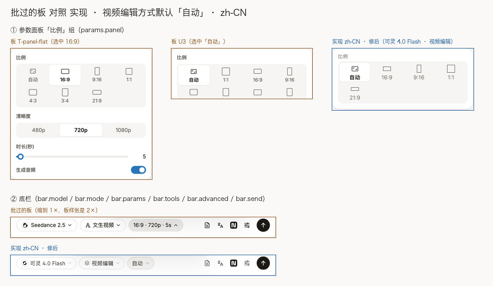
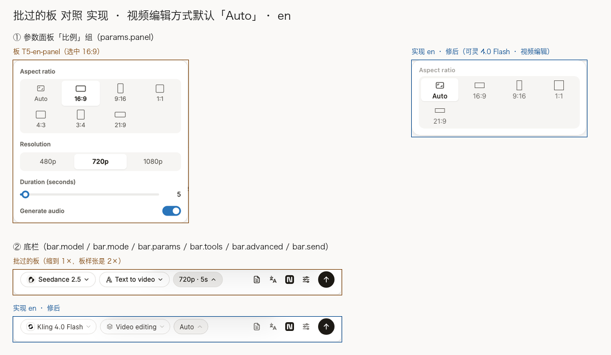

# 批过的板 ↔ 实现（中英对照）· 可灵视频编辑默认「自动」· PR #1621

## 板在哪

这个 PR 是纯修 bug（视频编辑方式没手选比例时默认跟随原视频，见 `docs/plan/2026-11-14-mode-input-check.md` §2 C3 / §5 PR3），本身没有专属拍板图；它改的那个控件（底栏「参数」格 + 参数面板的「比例」组，含「自动」）属于已批的板：

- `docs/design/boards/2026-11-14-composer-params/ComposerParams.board.json`（用户 2026-11-14 拍板，`stage: built`）
  - 样张：`preview/T-panel-flat.png`（zh，选中 16:9）、`preview/T5-en-panel.png`（en，选中 16:9）、`preview/U3-single-advanced.png`（zh，**选中「自动」**）。
- 方式名叫法归 `docs/design/boards/2026-11-12-mode-bar/ModeBar.board.json`，下面 #4 会用到。

## 实现从哪来

用的是本 PR 自带的真 Electron 窗口「修后」截图 [`after-zh.png`](after-zh.png) / [`after-en.png`](after-en.png)（可灵 4.0 Flash，连入源视频进「视频编辑」方式，打开比例浮层；`NOMI_TEST_NETWORK_GUARD=1`，不发付费请求）。它们拍于本分支功能提交 `fb014c1e8`；之后合入 `origin/main` 只动了 `src/i18n/locales/onboardingProviders.ts`（与这一屏无关；`git diff` 过 `src/workbench/generationCanvas`、`src/design`、`src/i18n` 只有这一个文件），所以没有重拍。修前对照图仍是 [`before-zh.png`](before-zh.png) / [`before-en.png`](before-en.png)（默认 16:9）。

对照拼图：

- 中文：
- 英文：

板样张是 2× 出图，拼图里已缩到 1× 与实现同比例（组合框宽 600、参数面板宽 ≈320 两边一致）。

## 逐条对账（zh / en 同结论，除非另写）

| # | 板元素（`ComposerParams`） | 结论 | 说明 |
|---|---|---|---|
| 1 | `composer.shell` 生成框外壳：定宽 600、钉在节点正下方的圆角卡片 | 没差别 | 实现卡片 x 366→966 = 600，位置在节点正下方 |
| 2 | `composer.refs` 参考那一行 | 有差别 | 见 D1 |
| 3 | `composer.prompt` 提示词区 | 没差别 | 占位 / 正文样式同板；正文文字是各自示例（板：她从清晨的码头…；实现：把天空改成黄昏暖橙色…），数据不是 UI |
| 4 | `bar.mode` 底栏第二格：生成方式 | 有差别 | 见 D2 |
| 5 | `bar.model` 底栏第一格：品牌图 + 模型名 | 没差别 | 板示例是 Seedance 2.5，实现是 `可灵 4.0 Flash` / `Kling 4.0 Flash`；格子样式、品牌图、下拉箭头一致 |
| 6 | `bar.params` 底栏第三格：比例 · 清晰度 · 时长 | 有差别 | 见 D3（**这就是本 PR 改的那一格**） |
| 7 | `bar.tools` 底栏右侧：提示词预设 / 翻译 / 用 Nomi 优化 | 没差别 | 三颗图标同序同样式 |
| 8 | `bar.advanced` 高级设置滑杆图标 | 没差别 | 图标在、位置同板；这个方式有「提交前内容审核」一项，所以按「有就出」规则出现 |
| 9 | `bar.send` ↑ 生成钮 | 没差别 | |
| 10 | `params.panel` 参数面板：全摊开；只有一项时不再是窄条 | 有差别 | 见 D4；「比例」组本身（标题 → 瓷砖网格 → 选中白底加粗）没差别，「自动」瓷砖带图标、排第一，同 U3 |
| 11 | `params.option-group.capped` 选项最多的一格限 3 行 | 不涉及 | 这个方式只有 5 个比例，不触发 |
| 12 | `advanced.section` / `help.mark` / `help.text` | 不涉及 | 本屏没展开高级设置；与本 PR 无关 |
| 13 | `storyboard.row` 分镜行同一只组件 | 不涉及 | 本截图在画布节点上；分镜行用同一个组件，没单独截 |

## 有差别的逐条理由

**D1 · 参考行多一个视频缩略格、行尾多一段数量字（#2）**
- 板的参考行只画了「选择 / 添加」两个方块（文生视频、首尾帧示例）；实现里「视频编辑」方式必须连入源视频，所以多出一格视频缩略图（金色播放块），行尾右侧出现 `视频 1` / `1 video`。
- 理由：这是 `kling4Flash.ts` 里编辑方式的源视频槽位（`video_ref`，必填 1 个）带来的内容；行尾数量字属 `ModeBar` 板的 `ref.tail.count`（按类型报数），不是 `ComposerParams` 的元素，本次只核存在、没有另做并排。

**D2 · 方式名是「视频编辑 / Video editing」，图标也不同（#4）**
- 板示例画的是 `文生视频 / Text to video`；`ModeBar` 板统一叫法只列了 `文生视频 / 图生视频 / 首尾帧 / 全能参考`，没有「视频编辑」。
- 理由：`视频编辑` 是可灵 4.0 Flash 模型档案里的方式名（`electron/shared/videoCapabilities/kling4Flash.ts` 的 `vendorTerm`），方式格按「模型自己有哪些方式」现算，不是 UI 另写的；图标随方式（编辑用叠层图标）。没有新增文案：中英沿用既有 `视频编辑` / `Video editing`。

**D3 · 参数格显示「自动 / Auto」，而不是「16:9 · 720p · 5s」（#6）**
- 板示例（Seedance、文生视频）摘要由比例、清晰度、时长三个值拼成；实现只显示 `自动` / `Auto`。
- 理由：可灵 4.0 Flash 的编辑方式只声明了「比例」一个会进摘要的参数（`params: [ASPECT_FOLLOW, NSFW_CHECK]`，审核开关进高级设置；清晰度只有 720p 不渲染、编辑方式不声明时长，源视频定时长），摘要规则是「已选参数的值，按序拼」，所以只剩一个值。该值取「自动」而不是 `16:9` 正是本 PR 的修复：以前未手选时被铺成 `16:9`（见 `before-zh.png` / `before-en.png`），现在清掉机器铺的值回到「自动」。
- 板上没有画「摘要里的值是自动」这种形状；规则（摘要 = 选中项的标签）与板一致，所以不算偏离，只是样张没覆盖到。

**D4 · 面板只有「比例」一组，瓷砖数量和顺序与板示例不同（#10）**
- 板 `T-panel-flat` / `T5-en-panel` 的面板还有清晰度、时长、生成音频三组、7 个比例；实现面板只有「比例」一组、5 个比例（自动 / 16:9 / 9:16 / 1:1 / 21:9），第二行只剩 21:9。
- 理由：同 D3，面板内容由该方式声明的参数决定（这就是板 `params.panel` 里「只有一项时不再是窄条」的那种情况，实现里宽度仍是 ≈320，没有退成窄条）。比例的选项与顺序来自模型档案 `ASPECT_FOLLOW`（`auto`、16:9、9:16、1:1、21:9）；板的 `U3` 是图片模型，顺序（自动、1:1、16:9…）本来就按各自模型档案排。
- 板里没有 en 版「选中自动」的样张（`T5-en-panel` 选中的是 16:9）；en 的「Auto」选中态拿 zh `U3` 的选中样式（白底、加粗、图标在上）核对，实现 en 与 zh 同样式。

## 复现

`after-*.png` 即本 PR「真实场景复现」所用路径：画布新建视频节点 → 选可灵 4.0 Flash → 连入源视频 → 底栏方式为「视频编辑」→ 点参数格打开比例浮层，读回选中值与 `meta.aspect_ratio`。对照拼图由板样张与这四张截图按固定坐标裁剪、缩放拼接，不改像素。
