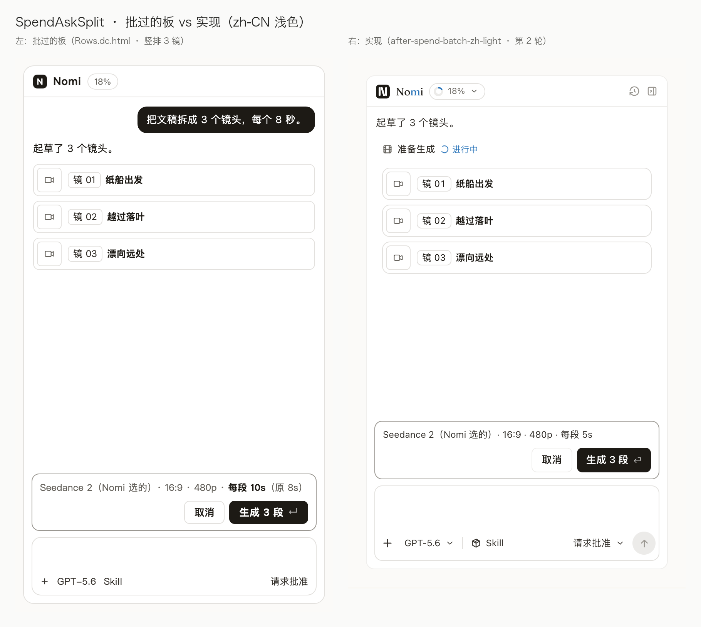
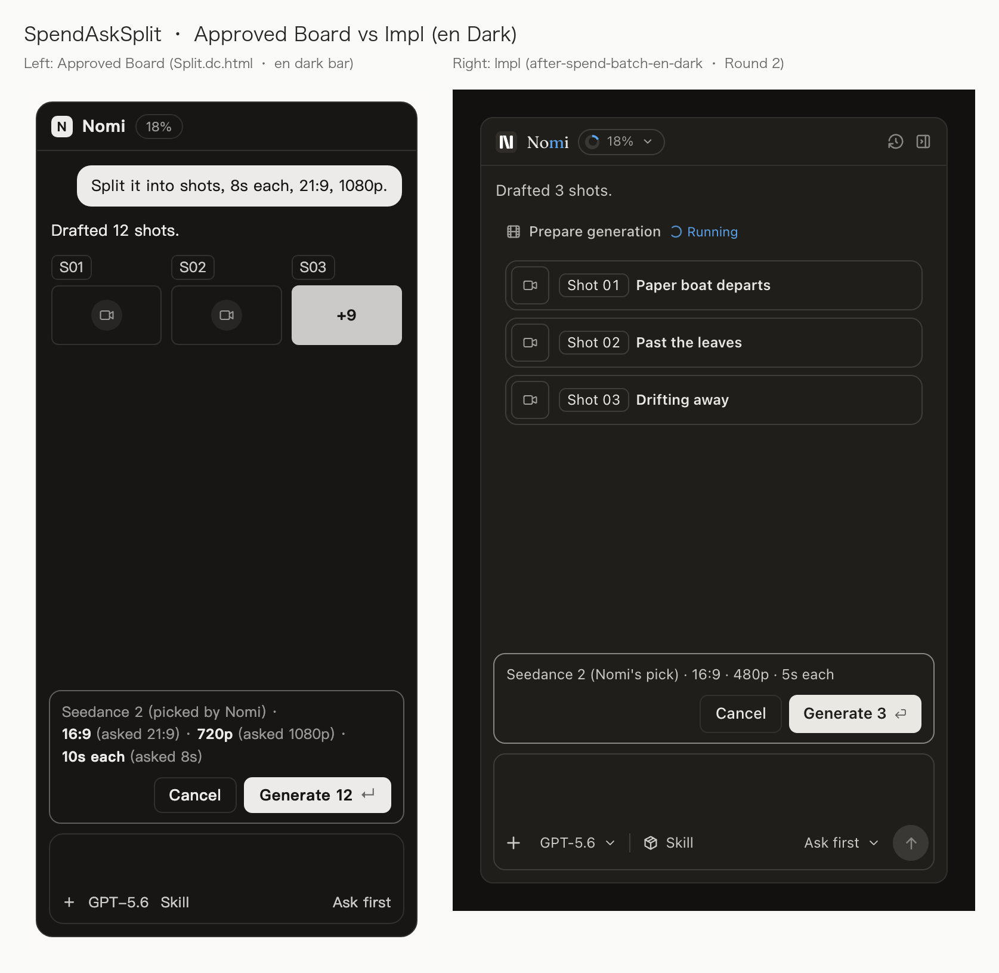

# 批过的板 ↔ 实现（中英对照）· SpendAskSplit · PR #1548

- 板：`docs/design/boards/2026-11-15-spend-ask-split/SpendAskSplit.board.json`，样张 `docs/design/boards/2026-11-15-spend-ask-split/source/Rows.dc.html`（用户 2026-11-15 拍板「按竖排做没有问题」，中文浅色）与 `source/Split.dc.html`（英文深色确认条 `Cancel / Generate 12 ↵`，横排已被 `Rows.dc.html` 竖排取代）。
- 实现：第 2 轮对齐后（`8b6e0ee32c59`）的生产组件 `spend-batch` 截图（`after-spend-batch-zh-light.png`、`after-spend-batch-en-dark.png`；另含停点付费工具审批卡改前/改后真窗口截图 8 张，见同目录 `README.md`）。拼好的对照图：
  - 中文：
  - 英文：

板上 15 格逐条对账（10 格本 PR 认领 `implemented`，4 格标 `missing` 由后续单认领，1 格标 `dropped`）。「没差别」= 并排逐项看过，结构、样式、文字与板一致（en 仅是译文）。

| # | 板元素 | 状态 | zh | en | 结论 |
|---|---|---|---|---|---|
| 1 | `ask.title` 去掉确认条顶部标题 | `implemented` (`remove`) | 没差别 | 没差别 | 确认条顶部无标题行，直接一行共同参数 |
| 2 | `ask.pointers` 去掉确认条内镜头网格 | `implemented` (`remove`) | 没差别 | 没差别 | 确认条内指向元素数 = 0，镜头只在对话里 |
| 3 | `ask.params` 共同参数一行 | `implemented` | 有差别 | 有差别 | 见下 D1（`ask.params.asked` 属未认领下一刀，且本例时长未改） |
| 4 | `ask.actions` 取消 + 生成 N 段（`md` 按钮、无横线、en 无名词） | `implemented` | 没差别 | 没差别 | 确认条两行之间无横线；按钮 `WorkbenchButton size="md"`（32px / 13px / 主按钮 600 / `⏎` 400）；zh `生成 3 段 ⏎`，en `Generate 3 ⏎`（对标板 `Generate 12 ↵`）；无托管告知 |
| 5 | `ask.sending` 发出中只留进度与取消 | `implemented` | 未拼进本图 | 未拼进本图 | 已有实验室与走查断言覆盖；与板唯一差别已写入板注：发出中用安静浅线框而非深描边 |
| 6 | `chat.rows` 对话内竖排镜头行（小缩略图 + 镜号胶囊 + 标题，无行尾状态图标） | `implemented` | 有差别 | 有差别 | 行内结构、空缩略图种类图标、收紧镜号胶囊（20px 高、`px-1.5`、`rounded-nomi-sm`）均与板一致；整段消息多 1 行进程头见下 D2，英文板本身仍为横排示意见下 D3 |
| 7 | `chat.rows.more` 超过 4 镜折成「还有 N 个镜头 ›」 | `implemented` | 未拼进本图 | 未拼进本图 | 本对照图取 3 镜组，折起态由 `NodePointer.test.tsx` 与真窗口走查实点核验 |
| 8 | `chat.rows.exclude` 悬停 `×` 去掉、行尾「恢复」 | `implemented` | 未拼进本图 | 未拼进本图 | 交互态由真窗口 7 类控件实点与单测核验 |
| 9 | `chat.rows.note` 异参/状态写在该行第二行 | `implemented` | 未拼进本图 | 未拼进本图 | 本对照图 3 镜同参待发故仅 1 行，与板「参数都一样时每行只有这一行字」一致 |
| 10 | `chat.receipt` 发完后同组留「已发出 N 段」中性色收据 | `implemented` | 未拼进本图 | 未拼进本图 | 由 `GenerationReceiptPointers.test.tsx` 与真窗口走查核验 |
| 11 | `ask.params.asked` / `chat.rows.note.asked`（落的和原本要的不一样） | `missing` | 不比对 | 不比对 | 移交 `Agent 意图落参 2b`（本 PR 不做） |
| 12 | `ask.cost`（按钮行左侧费用预估） | `missing` | 不比对 | 不比对 | 移交 `ModelSurfaces cost.batch-card`（按钮行左侧已留空位） |
| 13 | `ask.failure`（失败原因与再试完全挪进行里、收走红条） | `missing` | 不比对 | 不比对 | 移交另一刀带设计卡（本 PR 已去掉条上重复红字原因） |
| 14 | `chat.rows.horizontal`（横排三格） | `dropped` | 不比对 | 不比对 | 用户 2026-11-15 拍板选竖排，已标 `dropped` |

## 有差别的逐条理由

**D1 · 确认条共同参数未显示「（原 8s）」/「(asked 21:9)」且英文用 `Nomi's pick`（#3）**
- 板上样张画的是「模型不支持 8s 被落成 10s」的示意（`每段 10s（原 8s）`、`16:9 (asked 21:9)`），该项在板清单中明确标为 `ask.params.asked: missing`（归后续单 `Agent 意图落参 2b`）；本 PR 截的是同参 5s 场景，因此不出现括号标注。
- 英文模型来源后缀实现为 `(Nomi's pick)`，比板手写 `(picked by Nomi)` 更短，沿用既有 `agentPanelV4` 词典。

**D2 · 对话镜头组上方多 1 行「准备生成 · 进行中 / Prepare generation · Running」（#6）**
- 板上只画了模型文本「起草了 3 个镜头。」紧接 3 条镜头行；真面板里生成记录归属一次真实工具调用（`generate` 处于待确认等待态），进程行由既有 `AgentPanelV4Panel` 工具流渲染，且位置在镜头组上方（不打断镜头行与确认条的上下对应）。

**D3 · 英文板样张仍是旧横排 12 镜，英文实现采用拍板后的竖排 3 镜（#6）**
- 英文深色样张只画在 `Split.dc.html` 第 4 列（窄屏 320px、横排 3 格 `+9`）；后续 `Rows.dc.html` 拍板竖排方案时未另画英文深色版，因此 `board-vs-impl-en.png` 左侧拿 `Split.dc.html` 核对英文深色配色与底部确认条（`Cancel` / `Generate N ⏎` 无名词），右侧镜头行按拍板竖排渲染（`Shot 01 / Shot 02 / Shot 03`）。

**D4 · 按钮高度 32px（`WorkbenchButton size="md"`）vs 板手写 CSS 约 30px（#4）**
- 板上 `.b1/.b2` 用 `padding: 4px 12px` 算出约 30px，设计系统按钮阶梯无 30px 档，按协调 2026-11-22 拍板 D2 统一取设计系统现役组件 `WorkbenchButton size="md"`（32px 高 / 13px 字，主按钮 `font-semibold`，`⏎` `font-normal`），不写任意值。

**D5 · 停点附带影响：付费工具审批卡（`before/after-tool-spend-*.png`）**
- 独立 `V4SpendBar` 一并承接 `effectClass: "spend"` 付费工具审批卡（按钮由 `sm` 28px 升至 `md` 32px，卡高 `149.9px → 153.9px`）。该卡不在 `SpendAskSplit` 板上，真窗口改前/改后中英明暗 8 张对照图已单列在 `README.md` 与 PR 正文停点节，供用户合并前点头。
