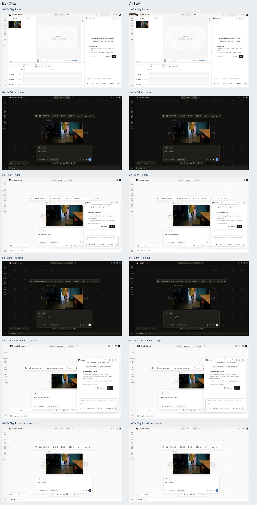

通过

验收 HEAD：590d801bb7ae9a6d18a3fdd0d416a0e732dad7e7
录像实现提交：1dcfe089b35daf7846fb3d92e134477c4b1f4d4a
验收线：window_acceptance
基线：1730b7ea3db4adb513e0166c0376cce113f3f018

# 真实桌面窗口

六条修改前录像沿用基线 1730b7ea3 的原始记录。浏览器探针修复后，从 1dcfe089b 的新构建重录六条修改后录像，并重测按钮状态。验收 HEAD 590d801b 与实测实现 1dcfe089b 之间只更新了根因记录和概念登记；已用 package-build-stamp verify 核对 renderer 及 Electron 源码指纹。性能、源码门岗及单测由该目录的其他收据记录。录像来自 Playwright 驱动的 macOS Electron 桌面窗口，逐条读取系统的 ApplicationType 均为 UIElement。隔离项目使用仓库登记的 640×360 真实雨衣镜头抽帧及本机回环模型。生成键按住、移出后松开；12 条录像均读回媒体请求 0 次。每条录像从真实项目的创作面开始，经预览、生成，在画布选中镜头、读工具条和输入框，最后展开 Agent 面板。按下时检查 :active 并读取渲染宽度。短片以原速保留每次交互前后约两秒，片段间直接切换。连续未剪版位于 /tmp/mo1-window-evidence/final/videos/。

下表的比例是按住时宽度除以空闲宽度。末列是预览导出文字钮的 computed transitionDuration。

| 窗口 | 修改前录像 | 修改后录像 | 文字钮前 → 后 | 发送钮前 → 后 | 节点工具图标前 → 后 | 过渡时长前 → 后 |
|---|---|---|---:|---:|---:|---|
| zh-CN / light | [before](before-zh-light.mp4) | [after](after-zh-light.mp4) | 1.000 → 0.970 | 1.000 → 0.970 | 1.000 → 1.000 | 0.15s → 0.11s |
| zh-CN / dark | [before](before-zh-dark.mp4) | [after](after-zh-dark.mp4) | 1.000 → 0.970 | 1.000 → 0.970 | 1.000 → 1.000 | 0.15s → 0.11s |
| en / light | [before](before-en-light.mp4) | [after](after-en-light.mp4) | 1.000 → 0.970 | 1.000 → 0.970 | 1.000 → 1.000 | 0.15s → 0.11s |
| en / dark | [before](before-en-dark.mp4) | [after](after-en-dark.mp4) | 1.000 → 0.970 | 1.000 → 0.970 | 1.000 → 1.000 | 0.15s → 0.11s |
| en / light / 1100 × 690 | [before](before-narrow.mp4) | [after](after-narrow.mp4) | 1.000 → 0.970 | 1.000 → 0.970 | 1.000 → 1.000 | 0.15s → 0.11s |
| zh-CN / light / reduce | [before](before-reduce.mp4) | [after](after-reduce.mp4) | 1.000 → 1.000 | 1.000 → 1.000 | 1.000 → 1.000 | 0.15s → 0s |

在同一选中节点上，减弱动态模式先缩小一步，再点击适应视图；监听 React Flow 实际视口的 transform 写入并去重，修改前观测到 11 个新姿态，修改后为 1 个新姿态，落点与起点不同。四种宽窗口实测 1280×800，窄窗口实测 1100×690。系统偏好由 Playwright 媒体仿真施加，窗口 DOM 对每种条件独立读回了语言、颜色模式、偏好和尺寸。坐标、按压比例、时长、视频帧索引和媒体请求计数见 [窗口原始读数](window-probes.json)。

已逐行目验并排帧。创作、生成、预览段的选中态可辨；中英文亮暗两轨上工具条、发送箭头和 Agent 面板均可见，窄窗保留原来的浮窗形态。

## 按钮加载

另在隔离 Chromium 内挂载真实 WorkbenchButton、DesignButton、WorkbenchIconButton 和 IconActionButton，使用对应版本的 Tailwind 样式、Mantine 主题和产品翻译。点击切换 loading 后，在相同英文标签、相同父容器中量 border box，等待渲染落定再读回状态。

| 组件 | 修改前 idle / loading (px) | 修改后 idle / loading (px) | 减弱动态下 loader |
|---|---:|---:|---|
| WorkbenchButton | 126.390625 / 146.390625 | 126.390625 / 126.390625 | animationName=none，opacity=0.65 |
| DesignButton | 128.890625 / 150.890625 | 128.890625 / 128.890625 | animationName=none，opacity=0.65 |

两个按钮在 loading 时均为 disabled、aria-busy=true。加载标 role=status、aria-label=Loading、aria-busy=true。再按禁用钮，外宽仍等于空闲宽度。两种图标按钮在普通和减弱动态下按住均保持 32 px。原始分状态读数见 [组件测量](button-probes.json)。

## 反例与复跑

- 将相同按压和宽度判据用于基线，正常模式的文字钮和发送钮按压比例均为 1，两种文字按钮进入 loading 后分别变宽 20、22 px；当前版本通过相同判据。
- 全部停掉反馈会违反正常模式下两种文字按钮和发送钮的 0.97 按压比例。全都缩小会违反图标工具栏及减弱动态时的静态判据。
- 用 verify-nomi 常驻驱动复查项目画布和常驻 Agent 入口。矩阵录制另复用 core-smoke/fixture.mjs、verifyFeatures.mjs 和 _shell.mjs，以捕捉真实连续帧、持续按住并设置精确窄窗。仓外脚本和命令记录位于 `/tmp/mo1-window-evidence/`。
- `node scripts/verify-line-meter.mjs /tmp/mo1-window-evidence --json` 读回 2 个驱动脚本、194 行、6 次常驻命令。Windows 与真实模型生成不在这条验收线的实测范围。
